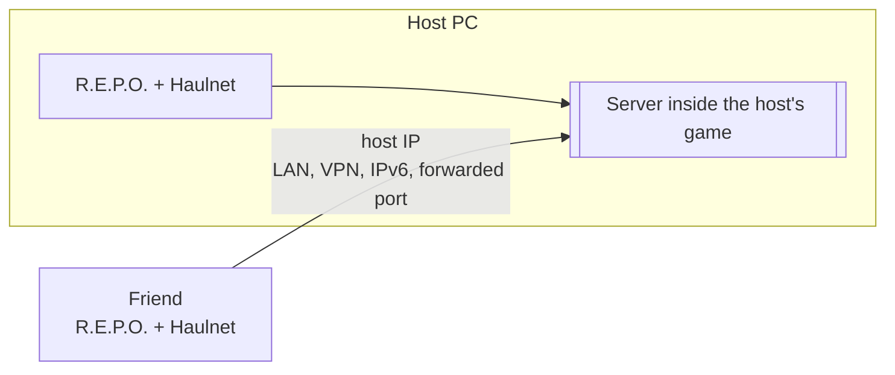

# Haulnet

**LAN and direct multiplayer for R.E.P.O., without Photon Cloud.**

R.E.P.O. has no local mode: even two players on the same network play through Photon's servers, and
players far from Photon's data centers get high ping. Haulnet brings local play back, like "Open to LAN"
in Minecraft. The host creates a game "On my PC" and a server runs inside their game; friends accept
the Steam invite as usual and connect straight to the host over the same LAN, any VPN they already use
(WireGuard, Radmin, ZeroTier, Tailscale), IPv6, or a forwarded port. No Photon account, no admin rights,
no `hosts` edits.

> [!WARNING]
> **Pre-alpha.** Hosting works in single-PC tests; joining through an invite still needs a two-player test,
> and the first release is next. There is no packaged release yet: build from source (below).

## How it works



- The mod redirects the game's Photon connection to a server you choose instead of Photon Cloud.
- When you host "On my PC", it runs [LuxonServer](https://github.com/niansa/LuxonServer), an open-source
  Photon-compatible server, inside your game session, and stops it when you leave.
- Joining players can use any of the host's addresses; the mod keeps all connections, including voice
  chat, on the address they used.

## Usage

Every player installs the mod. Out of the box nothing changes: the game plays through Photon Cloud as usual.

Haulnet adds a **HAULNET** section to the game's region page, which both *Private game* and *Public game*
open. Pick where the game lives there, exactly like picking a region; the Photon regions stay below it.

- **On my PC** (private games): like Minecraft's "Open to LAN". Enter the UDP port (the last one is
  prefilled, 27000 by default); a server starts inside your game on that port and the next two. The lobby shows
  "Haulnet · on your PC · UDP 27000-27002". How friends reach your PC (same network, a VPN, a forwarded port) is
  up to you; Haulnet does not guess. Invite friends through Steam; the invite carries your addresses and port.
  The server stops when you return to the main menu.
- **Your servers**: servers you played on recently (up to 5) with their ping, and servers you saved in the
  config file. A server that runs the `haulnet-server` package shows its name and whether it is full.
- **+ Server by address...**: type `host` or `host:port` (port 27000 if not given; Ctrl+V pastes). Use it for
  a server you run yourself or one a friend told you about; it does not need to be listed anywhere.
- **Photon Cloud regions**: the normal game; friends without Haulnet can join too.

On a server, a private game works as usual (invite friends through Steam); a public game opens the game's own
*Public game* page, so *Random matchmaking* and the *Server list* (with *Create new*) work on that server.

**Friends:** accept the Steam invite or use *Join friend*, as always. The invite says where the game lives:
on a server, or on the host's PC with all of the host's addresses and the port; Haulnet uses the address that
answers first and connects there. The lobby shows where you are connected. If the connection fails, the
friend sees which addresses and port were tried, and the host sees who got no answer. After leaving,
everything is back to normal.

Network: the server on your PC uses the port you enter and the next two (**UDP 27000-27002** by default);
the address check between a friend and the host uses **UDP 47777** and is optional. Windows Firewall may ask
whether `luxon_server` and R.E.P.O. may use the network.

Lobby password, kick and ban work in Haulnet games too. Photon Cloud checks them on its servers; in a
Haulnet game the host's mod does it, so a refused player may appear in the lobby for a moment before
being removed.

All players need the same game version, and everyone in a Haulnet game needs Haulnet.

## Building from source

Requirements: a legal copy of R.E.P.O., [BepInEx 5](https://github.com/BepInEx/BepInEx/releases)
installed in the game, the [.NET SDK](https://dotnet.microsoft.com/download) 8 or newer, and internet access
for the first build.

1. Copy `mod/Directory.Build.user.props.example` to `mod/Directory.Build.user.props` and set `GameDir` to the
   folder that contains `REPO.exe`.
2. Build:

   ```bash
   dotnet build mod/Haulnet.sln -c Release
   ```

   The build downloads the pinned LuxonServer release, verifies its SHA-256 and puts it under `server/` next
   to the plugin. With `DeployToGame` set to `true`, the result is copied to
   `<GameDir>/BepInEx/plugins/Haulnet`.

Game, Photon and BepInEx assemblies are referenced from your installation and never included in this
repository.

Settings are stored in `BepInEx/config/haulnet.repo.cfg`: the last hosting port, saved servers
(`[Servers] Saved = Name=host[:port];...`) and the recent list. To remove the mod, delete
`BepInEx/plugins/Haulnet`; to remove BepInEx as well, delete `BepInEx`, `winhttp.dll`,
`doorstop_config.ini` and `.doorstop_version` from the game folder.

## Planned

- Automatic port forwarding on routers that support UPnP.
- Community relays: when no direct path exists, traffic goes through a relay that anyone can host, picked
  automatically by ping.
- Thunderstore release.

## Not supported

Unlicensed copies of the game. Haulnet is for people who own R.E.P.O. on Steam.

## Disclaimer

Haulnet is an independent fan project. It is not affiliated with or endorsed by semiwork (developers of
R.E.P.O.) or Exit Games GmbH. "R.E.P.O." and "Photon" are trademarks of their respective owners and are used
only to describe compatibility.

## License

[MIT](LICENSE). Bundled third-party components keep their own licenses; see
[THIRD_PARTY_NOTICES.md](THIRD_PARTY_NOTICES.md).
