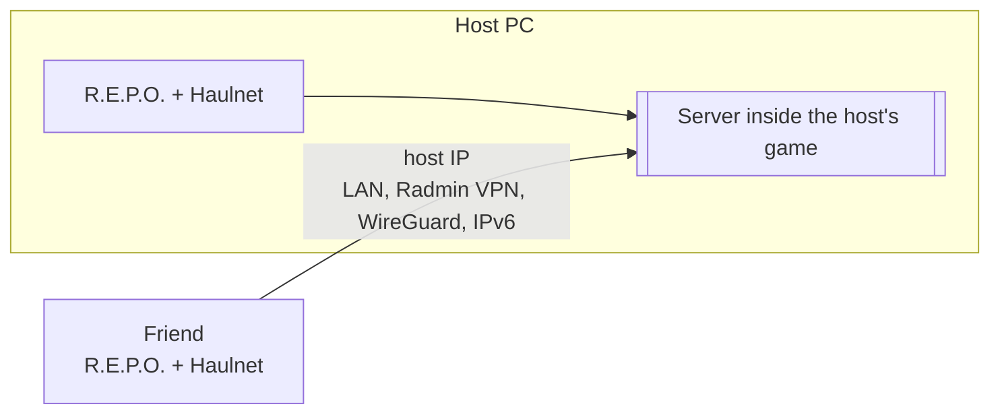

<p align="center">
  <a href="https://haulnet.cc/">
    <picture>
      <source media="(prefers-color-scheme: dark)" srcset="https://haulnet.cc/assets/haulnet-logo-on-dark.svg">
      
    </picture>
  </a>
</p>

<p align="center"><b>Play R.E.P.O. with friends on a server you control.</b></p>

<p align="center">
  <a href="https://github.com/haulnet/haulnet-repo/releases/latest"></a>
  <a href="https://github.com/haulnet/haulnet-repo/releases"></a>
  <a href="LICENSE"></a>
</p>

<p align="center">
  <a href="https://haulnet.cc/">Website</a> ·
  <a href="https://haulnet.cc/docs/install/">Install</a> ·
  <a href="https://haulnet.cc/docs/play/">Play</a> ·
  <a href="https://haulnet.cc/docs/server/">Run a server</a> ·
  <a href="https://haulnet.cc/docs/troubleshooting/">Troubleshooting</a> ·
  <a href="https://servers.haulnet.cc/">Server status</a>
</p>

R.E.P.O. runs every online game through Photon Cloud, even when friends sit on the same network. Haulnet is a free,
open-source mod that lets the game live on your own PC, on a Haulnet server or on any server by address instead.
No Photon account, no admin rights, and nothing changes until you pick a Haulnet place.

## Where you can play

Haulnet adds a **HAULNET** tab to the game's region page, next to **PHOTON CLOUD** (the game's own regions,
unchanged):

| Place | What it is |
|---|---|
| **On my PC** | Your game starts the server and friends connect straight to your PC, like Minecraft's "Open to LAN": over the home network, or over the internet through [Radmin VPN](https://www.radmin-vpn.com/) or [WireGuard](https://www.wireguard.com/). |
| **Haulnet servers** | Official and community servers, one row per city with its ping. Nobody needs to reach your PC. Live list: [servers.haulnet.cc](https://servers.haulnet.cc/). |
| **Server by address** | Any server you or a friend runs with [haulnet-server](https://github.com/haulnet/haulnet-server); it does not need to be listed anywhere. |

Friends join the usual way: they accept the Steam invite or use *Join game* in the Steam friends list, and their
Haulnet connects to wherever the game lives. Lobby password, kick and ban work in Haulnet games too.

## Install

Every player needs R.E.P.O. from Steam on Windows and
[BepInExPack](https://thunderstore.io/c/repo/p/BepInEx/BepInExPack/) (BepInEx 5), Haulnet's only dependency.

1. Install BepInExPack into the game folder and start the game once, so BepInEx creates its folders.
2. Download [Haulnet.zip](https://github.com/haulnet/haulnet-repo/releases/latest/download/Haulnet.zip) and extract
   it into `REPO/BepInEx/plugins`. You get `BepInEx/plugins/Haulnet/` with `Haulnet.dll` and the `server/` folder
   next to it.
3. Start the game: `BepInEx/LogOutput.log` contains a line like `Haulnet <version> loaded.`

Step by step, with Windows Firewall, updating and removing: [haulnet.cc/docs/install](https://haulnet.cc/docs/install/).

## Play

1. Open *Private game* or *Public game*. The region page now has the two tabs.
2. On the **HAULNET** tab, pick where the game lives, exactly like picking a region.
3. Invite friends through Steam as always.

Everyone in a Haulnet game needs Haulnet and the same game version; friends without it can still join you on the
**PHOTON CLOUD** tab. "On my PC" uses the UDP port you enter and the next two (27000–27002 by default), and
Windows Firewall may ask whether `luxon_server` and R.E.P.O. may use the network: allow it.

The full guide covers every row of the tab, how friends reach the host's PC and the config file:
[haulnet.cc/docs/play](https://haulnet.cc/docs/play/). Every message Haulnet shows is explained at
[haulnet.cc/docs/troubleshooting](https://haulnet.cc/docs/troubleshooting/).

## How it works



- The mod redirects the game's Photon connection, inside the game process, to the server you chose instead of
  Photon Cloud.
- "On my PC" runs [LuxonServer](https://github.com/niansa/LuxonServer), an open-source Photon-compatible server
  shipped with the mod, and stops it when you return to the main menu.
- A Haulnet server is the same LuxonServer packaged as [haulnet-server](https://github.com/haulnet/haulnet-server);
  the public list lives in [haulnet-servers](https://github.com/haulnet/haulnet-servers).

Haulnet never changes game files or system settings. Its settings are in `BepInEx/config/haulnet.repo.cfg`; to
remove the mod, delete `BepInEx/plugins/Haulnet`.

## Building from source

Requirements: a legal copy of R.E.P.O. with [BepInEx 5](https://github.com/BepInEx/BepInEx/releases) installed,
and the [.NET SDK](https://dotnet.microsoft.com/download/dotnet/8.0) 8.0 (`global.json` names the version, so
local builds and releases use the same compiler).

1. Copy `mod/Directory.Build.user.props.example` to `mod/Directory.Build.user.props` and set `GameDir` to the
   folder that contains `REPO.exe`.
2. Build and test:

   ```bash
   dotnet build mod/Haulnet.sln -c Release
   dotnet test mod/Haulnet.Tests
   ```

The build downloads the pinned LuxonServer release, verifies its SHA-256 and puts it under `server/` next to the
plugin; with `DeployToGame` set to `true` the result is copied to `<GameDir>/BepInEx/plugins/Haulnet`. Game, Photon
and BepInEx assemblies are referenced from your installation and are never part of this repository. The tests do
not need the game.

### Releases

To release, set the version in `mod/Haulnet/Haulnet.csproj` and `Plugin.cs`, move the "Unreleased" notes in
[CHANGELOG.md](CHANGELOG.md) under that version and merge. Then run the
[release workflow](.github/workflows/release.yml) on `main`: it builds the packages, takes the release notes from
the changelog and creates a draft release with the zip for manual install, the Thunderstore package
(`Haulnet-<version>-thunderstore.zip`) and `SHA256SUMS`. Publishing the draft creates the tag `vX.Y.Z`. Locally,
`dotnet build mod/Haulnet -c Release -t:Package` writes the same packages to `artifacts/<version>/`.

The workflow has no game installation. It compiles against reference assemblies: copies of the assemblies the mod
references in which every method body is removed, so they hold names and signatures and no code. A maintainer
makes them with [`tools/gamerefs`](tools/gamerefs) from their own installation after each game update; they stay
in a private repository and are never published:

```bash
dotnet run --project tools/gamerefs -c Release -- "<GameDir>" <empty folder> --game-version <version in the main menu>
```

## Translations

Haulnet follows the game's language. Its own texts exist in English, Russian and Ukrainian; other languages show
English.

Texts live in `mod/Haulnet/Localization/<language>.tsv`, one `KEY<TAB>text` per line; `en.tsv` is the source and
explains the placeholders and length limits. To add or fix a language, copy `en.tsv` to `<code>.tsv` (for example
`de.tsv` or `pt-BR.tsv`, as the game names its languages), translate the texts after the tab, run the tests and
open a pull request with a screenshot of the region page and of one popup in that language. Missing keys fall back
to English, so a partial translation works.

## Feedback

- Bugs and ideas: [issues](https://github.com/haulnet/haulnet-repo/issues). Attach `BepInEx/LogOutput.log` and
  say what you did.
- Security reports: privately, see [SECURITY.md](SECURITY.md).

## Not supported

Unlicensed copies of the game. Haulnet is for people who own R.E.P.O. on Steam.

## Disclaimer

Haulnet is an independent fan project. It is not affiliated with or endorsed by semiwork (developers of
R.E.P.O.) or Exit Games GmbH. "R.E.P.O." and "Photon" are trademarks of their respective owners and are used
only to describe compatibility.

## License

[MIT](LICENSE). Bundled third-party components keep their own licenses; see
[THIRD_PARTY_NOTICES.md](THIRD_PARTY_NOTICES.md).
