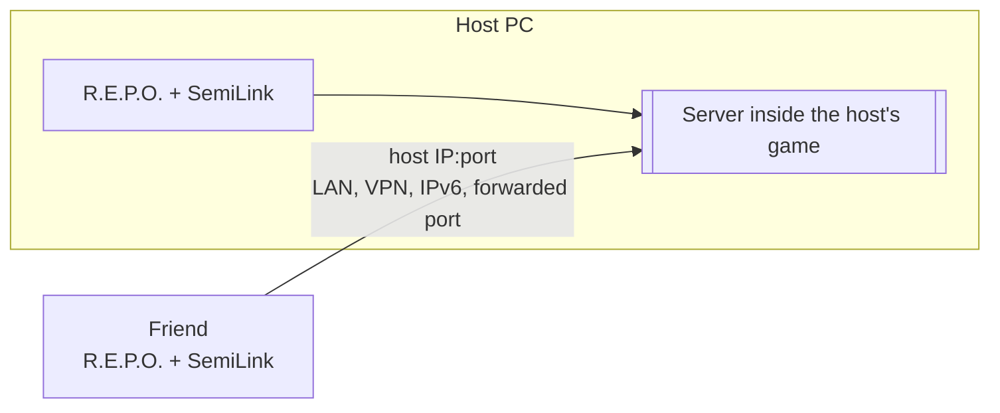

# SemiLink

**LAN and direct multiplayer for R.E.P.O., without Photon Cloud.**

R.E.P.O. has no local mode: even two players on the same network play through Photon's servers. SemiLink
brings it back, like "Open to LAN" in Minecraft. One player presses **Host** and the server runs inside
their game; friends join by address, from a LAN list or through a Steam invite. It works over the same LAN,
any VPN you already use (WireGuard, Radmin, ZeroTier, Tailscale), IPv6, or a router port SemiLink opens via
UPnP. No Photon account, no admin rights, no `hosts` edits.

> [!WARNING]
> **Pre-alpha.** Host and Join work in single-PC tests; a two-player test and the first release are next.
> Build from source: [mod/README.md](mod/README.md). See the [roadmap](docs/roadmap.md).

## Why

All multiplayer traffic in R.E.P.O. goes through Photon Cloud. If you are far from Photon's data centers,
every packet between you and a friend in the same city travels to another country and back. With SemiLink
it goes straight to the host.

Details and comparison with existing mods: [docs/why-semilink.md](docs/why-semilink.md).

## How it works

- **Client mod** (BepInEx): adds a *Cloud / Host / Join* switch. *Cloud* leaves the game untouched.
- **Server:** [LuxonServer](https://github.com/niansa/LuxonServer), an open-source Photon-compatible
  server, bundled with the mod and started by the Host button. An always-on standalone or Docker server is
  an optional extra for groups who want one.
- **Connection:** a plain IP address, so any network path works. A built-in connection helper for players
  with no path at all is designed and will be built if real-world data shows the need.

More: [docs/architecture.md](docs/architecture.md), [docs/connectivity.md](docs/connectivity.md).

## Planned features

- [x] Join by address (phase 1)
- [x] One-click Host, LAN discovery, address hints (phase 2)
- [ ] Steam invites, automatic port forwarding via UPnP, Thunderstore release (phase 3)
- [ ] Decision on a built-in connection helper (phase 4)
- [ ] Optional standalone and Docker server (phase 5)

## Requirements

- A legal copy of R.E.P.O. on Steam. SemiLink does not support unlicensed copies.
- BepInExPack for R.E.P.O.
- Every player in the session installs SemiLink.

## Documentation

- [Project rules](AGENTS.md): read before contributing
- [Documentation index](docs/README.md)
- [Contributing](CONTRIBUTING.md)

## Disclaimer

SemiLink is an independent fan project. It is not affiliated with or endorsed by semiwork (developers of
R.E.P.O.) or Exit Games GmbH. "R.E.P.O." and "Photon" are trademarks of their respective owners and are used
only to describe compatibility.

## License

[MIT](LICENSE). Bundled third-party components keep their own licenses; see
[THIRD_PARTY_NOTICES.md](THIRD_PARTY_NOTICES.md).
