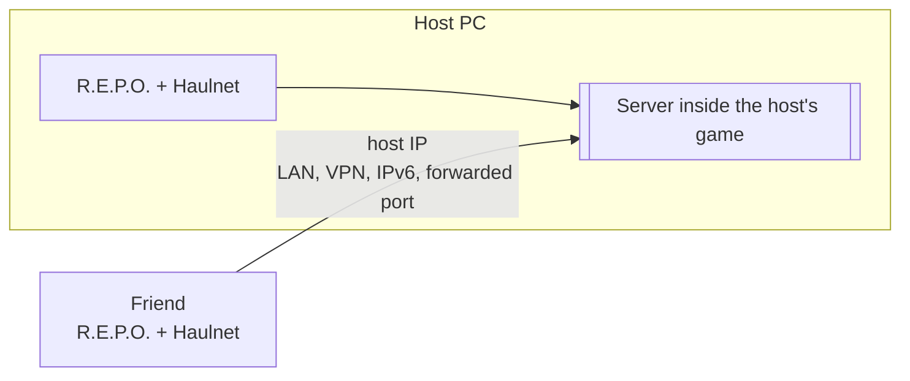

# Haulnet

**LAN and direct multiplayer for R.E.P.O., without Photon Cloud.**

R.E.P.O. has no local mode: even two players on the same network play through Photon's servers, and
players far from Photon's data centers get high ping. Haulnet brings local play back, like "Open to LAN"
in Minecraft. The host creates a game "On my PC" and a server runs inside their game; friends accept
the Steam invite as usual and connect straight to the host over the same LAN, any VPN they already use
(WireGuard, Radmin, ZeroTier, Tailscale), IPv6, or a forwarded port. No Photon account, no admin rights,
no `hosts` edits.

> [!WARNING]
> **Pre-alpha.** Hosting works in single-PC tests; joining through an invite still needs a two-player test,
> and the first release is next. There is no packaged release yet: build from source (below).

## How it works



- The mod redirects the game's Photon connection to a server you choose instead of Photon Cloud.
- When you host "On my PC", it runs [LuxonServer](https://github.com/niansa/LuxonServer), an open-source
  Photon-compatible server, inside your game session, and stops it when you leave.
- Joining players can use any of the host's addresses; the mod keeps all connections, including voice
  chat, on the address they used.

## Usage

Every player installs the mod. Out of the box nothing changes: the game plays through Photon Cloud as usual.

**Host:** *Private game* → the game asks **"Where to host?"**

- **On my PC**: a server starts inside your game. Create the game as usual and invite friends through Steam.
  The lobby shows "Haulnet · hosted on your PC". The server stops when you return to the main menu.
- **Photon Cloud**: the normal game; friends without Haulnet can join too.

Your last answer is offered first next time.

**Friends:** accept the Steam invite or use *Join friend*, as always. The invite carries the host's
addresses; Haulnet checks which one answers (LAN, VPN, IPv6, internet) and connects there. The lobby shows
which address is used. After leaving, everything is back to normal.

**Dedicated server (advanced):** press **F8** in the main menu, enter the server address and press *Use*;
the next *Public game* goes to that server.

Network: the server uses **UDP 27000-27002**; the reachability check uses **UDP 47777**. If Windows asks
whether `luxon_server` or R.E.P.O. may use the network, allow it, or friends cannot connect. Over the
internet without a VPN, the host must forward those UDP ports on their router.

All players need the same game version, and everyone in a Haulnet game needs Haulnet.

## Building from source

Requirements: a legal copy of R.E.P.O., [BepInEx 5](https://github.com/BepInEx/BepInEx/releases)
installed in the game, the [.NET SDK](https://dotnet.microsoft.com/download) 8 or newer, and internet access
for the first build.

1. Copy `mod/Directory.Build.user.props.example` to `mod/Directory.Build.user.props` and set `GameDir` to the
   folder that contains `REPO.exe`.
2. Build:

   ```bash
   dotnet build mod/Haulnet.sln -c Release
   ```

   The build downloads the pinned LuxonServer release, verifies its SHA-256 and puts it under `server/` next
   to the plugin. With `DeployToGame` set to `true`, the result is copied to
   `<GameDir>/BepInEx/plugins/Haulnet`.

Game, Photon and BepInEx assemblies are referenced from your installation and never included in this
repository.

Settings are stored in `BepInEx/config/haulnet.repo.cfg`. To remove the mod, delete
`BepInEx/plugins/Haulnet`; to remove BepInEx as well, delete `BepInEx`, `winhttp.dll`,
`doorstop_config.ini` and `.doorstop_version` from the game folder.

## Planned

- Automatic port forwarding on routers that support UPnP.
- Community relays: when no direct path exists, traffic goes through a relay that anyone can host, picked
  automatically by ping.
- Thunderstore release.

## Not supported

Unlicensed copies of the game. Haulnet is for people who own R.E.P.O. on Steam.

## Disclaimer

Haulnet is an independent fan project. It is not affiliated with or endorsed by semiwork (developers of
R.E.P.O.) or Exit Games GmbH. "R.E.P.O." and "Photon" are trademarks of their respective owners and are used
only to describe compatibility.

## License

[MIT](LICENSE). Bundled third-party components keep their own licenses; see
[THIRD_PARTY_NOTICES.md](THIRD_PARTY_NOTICES.md).
