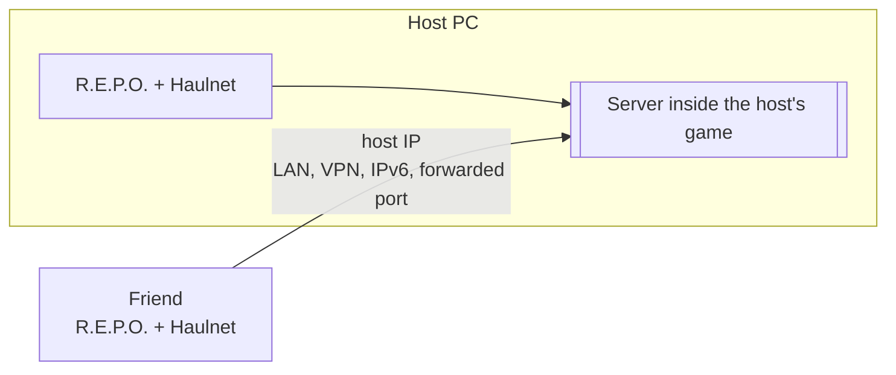

# Haulnet

**Play R.E.P.O. with friends on a server you control, instead of Photon Cloud.**

R.E.P.O. has no local mode: even two players on the same network play through Photon's servers, and
players far from Photon's data centers get high ping. Haulnet adds three ways to play without Photon Cloud:
on the host's own PC, like "Open to LAN" in Minecraft; on Haulnet servers (official and community); or on any
server by address. Friends accept the Steam invite as usual. No Photon account, no admin rights, no `hosts`
edits.

> [!WARNING]
> **Pre-release.** Tested by two players on two PCs: on an official Haulnet server and "On my PC" over a VPN
> (Radmin VPN). There is no packaged release yet: build from source (below).

## How it works

"On my PC": the server runs inside the host's game, and friends connect straight to it.



- The mod redirects the game's Photon connection to a server you choose instead of Photon Cloud.
- When you host "On my PC", it runs [LuxonServer](https://github.com/niansa/LuxonServer), an open-source
  Photon-compatible server, inside your game session, and stops it when you leave.
- Joining players can use any of the host's addresses; the mod keeps all connections, including voice
  chat, on the address they used.

## Usage

Every player installs the mod. Out of the box nothing changes: the game plays through Photon Cloud as usual.

Haulnet adds two tabs to the game's region page, which both *Private game* and *Public game* open:
**HAULNET** and **PHOTON CLOUD** (the game's own regions, unchanged). The tab you used last opens next time. Pick
where the game lives, exactly like picking a region.

The HAULNET tab lists your own places first and the public cities last, in this order:

- **On my PC** (private games only): like Minecraft's "Open to LAN". Enter the UDP port (the last one is
  prefilled, 27000 by default); a server starts inside your game on that port and the next two. The lobby shows
  "Haulnet · on your PC · UDP 27000-27002". How friends reach your PC is up to you (see *Reaching the host's PC*
  below); Haulnet does not guess. Invite friends through Steam; the invite carries your addresses and port.
  The server stops when you return to the main menu.
- **+ Server by address...**: type `host` or `host:port` (port 27000 if not given; Ctrl+V pastes). The last
  address whose game opened is prefilled. Use it for a server you run yourself or one a friend told you about;
  it does not need to be listed anywhere.
- **This PC · *name***: shown when a `haulnet-server` runs on your own PC.
- **Saved and recent servers**: one plain row each, with the server's name or address: first the servers you
  saved in the config file, then up to 5 you played on recently. The right side shows the ping, or *full* or
  *updating*.
- **One row per city**, e.g. *Europe [Moscow]*: the Haulnet servers (official and community) of the public
  [server list](https://servers.haulnet.cc/v1/servers.json), with ping. Haulnet checks every
  server of the city and uses one that answers, accepts games and runs a compatible version: for a private game
  the least busy of the closest ones, for a public game the busiest one, so public players of a city meet.
  Cities are ordered by quality, closest and most stable first: stability is the uptime over the last day and
  week measured by the public server monitor, named in the list. A server with recent outages moves down and is
  picked less often; without monitor data the order follows ping alone.

The **PHOTON CLOUD** tab is the normal game; friends without Haulnet can join there too.

On a server, a private game works as usual (invite friends through Steam); a public game opens the game's own
*Public game* page, so *Random matchmaking* and the *Server list* (with *Create new*) work on that server.

**Friends:** accept the Steam invite or use *Join game* in the Steam friends list, as always (both tested by two
players). The invite says where the game lives: on a server, or on the host's PC with all of the host's addresses
and the port; Haulnet uses the address that answers first and connects there. The lobby shows where you are
connected. If the connection fails, the friend sees which addresses and port were tried, and the host sees who
got no answer. After leaving, everything is back to normal. The game also has its own *Join friend* menu item;
how it behaves with Haulnet is not verified yet.

**Reaching the host's PC.** "On my PC" needs a network path from your friends to your PC; anything that connects
the two PCs works:

| Situation | What to do | Tested with two PCs |
|---|---|---|
| A VPN (Radmin VPN, ZeroTier, Tailscale, WireGuard...) | Everyone connects to the same VPN first; the invite contains your VPN address. | yes, Radmin VPN |
| Same home or LAN party | Allow the Windows Firewall prompt; friends use your local address from the invite. | not yet |
| Both sides have IPv6 | Your router must let incoming UDP through to your PC. | not yet |
| Router with a public IPv4 address | Forward UDP 27000-27002 (or your port and the next two) to your PC. | not yet |
| None of these (most home connections) | Create the game on a Haulnet server instead: nobody needs to reach your PC. | yes |

Network: the server on your PC uses the port you enter and the next two (**UDP 27000-27002** by default);
the address check between a friend and the host uses **UDP 47777** and is optional. Windows Firewall may ask
whether `luxon_server` and R.E.P.O. may use the network: allow it.

Lobby password, kick and ban work in Haulnet games too. Photon Cloud checks them on its servers; in a
Haulnet game the host's mod does it, so a refused player may appear in the lobby for a moment before
being removed.

All players need the same game version, and everyone in a Haulnet game needs Haulnet.

## Building from source

Requirements: a legal copy of R.E.P.O., [BepInEx 5](https://github.com/BepInEx/BepInEx/releases)
installed in the game, the [.NET SDK](https://dotnet.microsoft.com/download) 8 or newer, and internet access
for the first build.

1. Copy `mod/Directory.Build.user.props.example` to `mod/Directory.Build.user.props` and set `GameDir` to the
   folder that contains `REPO.exe`.
2. Build:

   ```bash
   dotnet build mod/Haulnet.sln -c Release
   ```

   The build downloads the pinned LuxonServer release, verifies its SHA-256 and puts it under `server/` next
   to the plugin. With `DeployToGame` set to `true`, the result is copied to
   `<GameDir>/BepInEx/plugins/Haulnet`.

Game, Photon and BepInEx assemblies are referenced from your installation and never included in this
repository.

Unit tests that do not need the game (translations, server status and monitor data parsing, server ranking,
and the bundled server's config and output):

```bash
dotnet test mod/Haulnet.Tests
```

### Release packages

```bash
dotnet build mod/Haulnet -c Release -t:Package -p:ThunderstoreTeam=<team>
```

writes `artifacts/<version>/` and publishes nothing:

| File | Contents |
|---|---|
| `Haulnet-<version>.zip`, `Haulnet.zip` | folder `Haulnet/` (plugin, `server/`, licenses, and `README.txt` from [`packaging/manual`](packaging/manual) with install steps for players): extract into `BepInEx/plugins` |
| `<team>-Haulnet-<version>.zip` | Thunderstore package: `manifest.json`, `icon.png`, `README.md` from [`packaging/thunderstore`](packaging/thunderstore), files under `plugins/` so mod managers keep the `server/` folder |
| `SHA256SUMS` | hashes of the zips |

The version comes from `mod/Haulnet/Haulnet.csproj` and must match `Plugin.Version` in `Plugin.cs`; the target
stops otherwise. Releases are built on a maintainer machine because the build needs the game's assemblies.

## Languages and translations

Haulnet follows the game's language (Settings → Language). Its own texts exist in English, Russian and
Ukrainian; in any other language they are shown in English, and the parts that belong to the game (such as
*Back*) are always in the game's language.

Texts live in `mod/Haulnet/Localization/<language>.tsv`, one `KEY<TAB>text` per line, the same format as the
game's own translation files; `en.tsv` is the source and explains the placeholders and length limits. To add or
fix a language, copy `en.tsv` to `<code>.tsv` (for example `de.tsv` or `pt-BR.tsv`, as the game names its
languages), translate the texts after the tab, run the checks above, and open a pull request with a screenshot of
the region page and of one popup in that language. Missing keys fall back to English, so a partial translation
works.

Settings are stored in `BepInEx/config/haulnet.repo.cfg`: the last hosting port, saved servers
(`[Servers] Saved = Name=host[:port];...`), the recent list, the last tab and the server list URL
(`RegistryUrl`; empty means the Haulnet list, a community can use its own list in the same format). The last downloaded server list is kept
in `BepInEx/cache/Haulnet` for offline use. To remove the mod, delete
`BepInEx/plugins/Haulnet`; to remove BepInEx as well, delete `BepInEx`, `winhttp.dll`,
`doorstop_config.ini` and `.doorstop_version` from the game folder.

## Planned

- Connection help for players who host "On my PC" without a VPN (under consideration, not decided).
- Thunderstore release.

## Not supported

Unlicensed copies of the game. Haulnet is for people who own R.E.P.O. on Steam.

## Disclaimer

Haulnet is an independent fan project. It is not affiliated with or endorsed by semiwork (developers of
R.E.P.O.) or Exit Games GmbH. "R.E.P.O." and "Photon" are trademarks of their respective owners and are used
only to describe compatibility.

## License

[MIT](LICENSE). Bundled third-party components keep their own licenses; see
[THIRD_PARTY_NOTICES.md](THIRD_PARTY_NOTICES.md).
