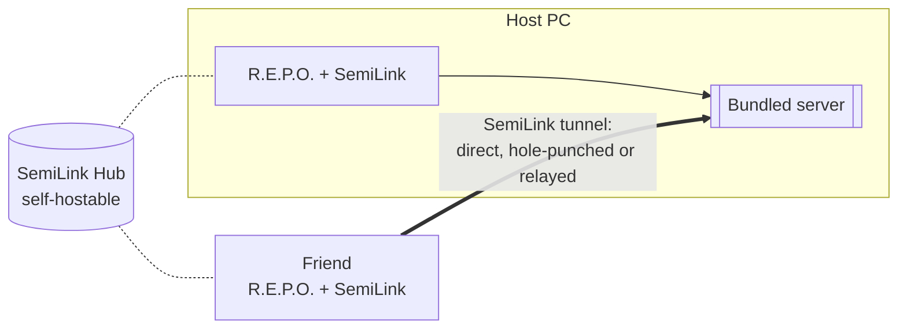

# SemiLink

**Play R.E.P.O. with friends through your own server instead of Photon Cloud.**

One player presses **Host**, friends join through a Steam invite or a session code, and the game runs on
the host's PC, a home server or a VPS. SemiLink connects the players itself: no Radmin, Hamachi or other
VPN programs, no admin rights, no Photon account, no `hosts` edits.

> [!WARNING]
> **Pre-alpha: design phase.** Nothing is installable yet. See the [roadmap](docs/roadmap.md).

## Why

R.E.P.O. routes all multiplayer traffic through Photon Cloud. If you are far from Photon's data centers,
every packet between you and a friend in the same city travels to another country and back. SemiLink
lets you put the server where it makes sense: on the host's PC, a home server, or a VPS near your group.

Details and comparison with existing mods: [docs/why-semilink.md](docs/why-semilink.md).

## How it works

- **Client mod** (BepInEx): adds a *Cloud / Host / Join* switch. *Cloud* leaves the game untouched.
- **Server:** [LuxonServer](https://github.com/niansa/LuxonServer), an open-source Photon-compatible
  server, bundled with the mod, or run standalone or in Docker for an always-on server.
- **Tunnel and Hub:** the mod carries game traffic between players over the best available path
  (LAN, IPv6, UPnP, NAT hole punching, relay). The Hub that coordinates it is self-hostable.

More: [docs/architecture.md](docs/architecture.md).

## Planned features

- [ ] Join a self-hosted server by address (phase 1)
- [ ] One-click Host (phase 2)
- [ ] Built-in tunnel with session codes, no VPN programs (phase 3)
- [ ] Relay fallback and Steam invites (phase 4)
- [ ] Docker images, standalone server, Thunderstore release (phase 5)

## Requirements

- A legal copy of R.E.P.O. on Steam. SemiLink does not support unlicensed copies.
- BepInExPack for R.E.P.O.
- Every player in the session installs SemiLink.

## Documentation

- [Project rules](AGENTS.md): read before contributing
- [Documentation index](docs/README.md)
- [Contributing](CONTRIBUTING.md)

## Disclaimer

SemiLink is an independent fan project. It is not affiliated with or endorsed by semiwork (developers of
R.E.P.O.) or Exit Games GmbH. "R.E.P.O." and "Photon" are trademarks of their respective owners and are used
only to describe compatibility.

## License

[MIT](LICENSE). Bundled third-party components keep their own licenses; see
[THIRD_PARTY_NOTICES.md](THIRD_PARTY_NOTICES.md).
