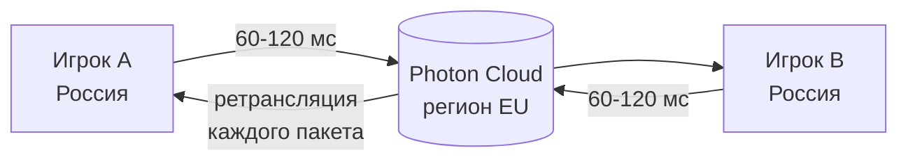
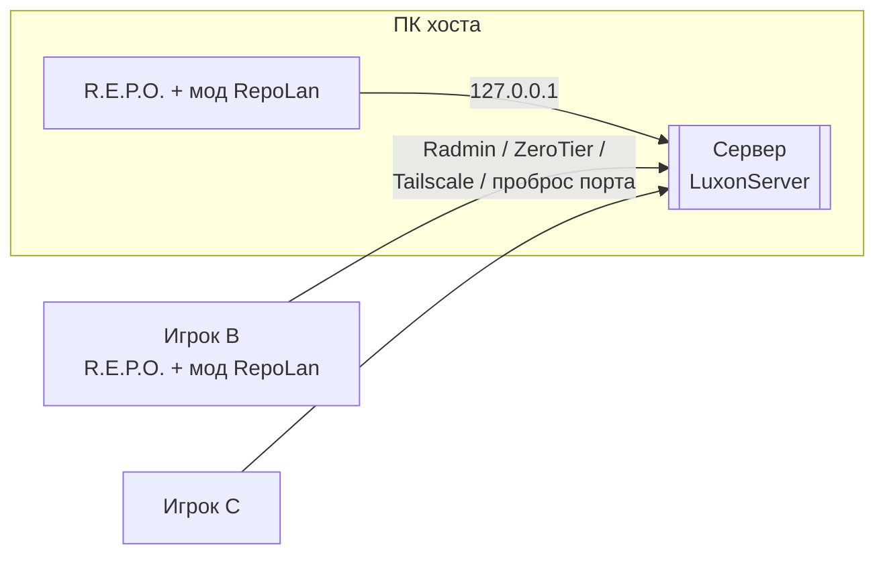
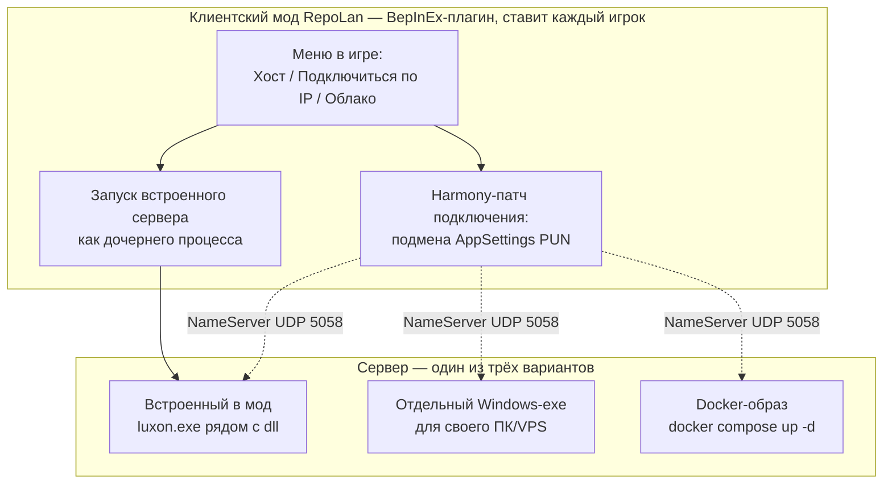
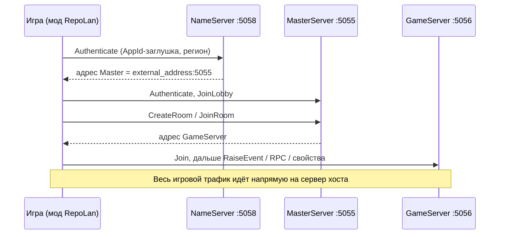
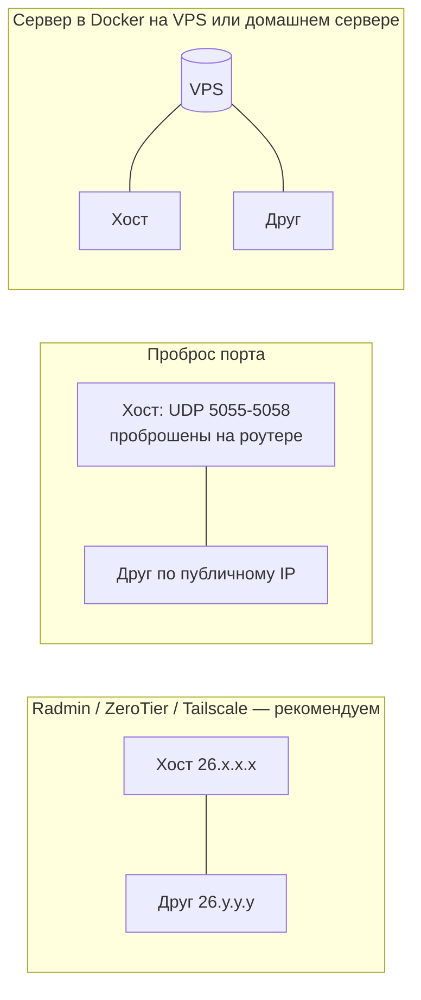

# 02. Архитектура

## Как сейчас (Photon Cloud)

Пакеты A→B идут через сервер Photon. Даже если игроки сидят в соседних домах, задержка равна
сумме двух «плеч» до Европы. В соло PUN работает в offline mode, поэтому пинг 0.

## Как будет (REPO LAN)

Игра думает, что говорит с Photon, но на деле общается с сервером на ПК хоста или на домашнем сервере.

## Компоненты

### 1. Клиентский мод (`RepoLan.dll`, BepInEx)

- Режимы: **Облако** (как сейчас, ничего не трогаем), **Хост**, **Подключиться** (ввести адрес).
- Патч через Harmony перед `PhotonNetwork.ConnectUsingSettings`:
  - `AppSettings.Server` ← адрес сервера, `Port` ← 5058 (NameServer), `UseNameServer = true`;
  - `FixedRegion` и AppId заполняем заглушками, сервер их не проверяет;
  - то же для Photon Voice (`AppIdVoice`), если голос идёт отдельным клиентом.
- **Без правки `hosts`**: LuxonServer предлагает перенаправлять `ns.photonengine.io` через hosts,
  но это требует админ-прав и ломает облачную игру во всех Photon-играх. Мод делает это точечно, только в R.E.P.O.
- В режиме «Хост» мод сам запускает сервер, показывает адрес, который нужно сказать другу
  (определяет IP Radmin, ZeroTier или Tailscale по сетевым интерфейсам), и гасит сервер при выходе из игры.

### 2. Сервер

Один и тот же LuxonServer с нашим `config.yml`, три способа поставки:

| Вариант | Для кого | Как запустить |
|---|---|---|
| Встроенный | Обычный игрок | Кнопка «Хост» в игре |
| Windows-exe | Отдельный ПК или VPS на Windows | Распаковать архив, запустить `start.bat` |
| Docker | Домашний сервер, NAS, Linux-VPS | `docker compose up -d` |

Важная настройка: `external_address`. NameServer отдаёт клиентам адрес Game-сервера,
поэтому там должен быть IP, по которому сервер видят **другие** игроки (адрес в Radmin или
публичный IP), а не `127.0.0.1`. Встроенный режим подставляет его автоматически.

Порты (UDP): 5058 (NameServer), 5055 (Master), 5056 (Game) плюс запасные 27000–27002.

## Последовательность подключения

## Сетевые сценарии

- **Виртуальная локалка** работает без настройки роутера, даже за CGNAT. Минус: всем нужно поставить
  одну и ту же программу. Tailscale и ZeroTier обычно строят прямой P2P-туннель; Radmin иногда идёт через свой relay.
- **Проброс порта** даёт минимальный пинг, но нужен белый IP и доступ к роутеру.
- **VPS** удобен, если хост не хочет держать сервер у себя. Пинг тогда зависит от расположения VPS
  (VPS в Москве для игроков из РФ всё равно лучше EU-региона Photon).

## Что намеренно НЕ делаем

- Не переписываем сетевую часть игры на P2P (Steam Networking или прямые сокеты): это переписывание
  транспорта PUN, его тяжело поддерживать после патчей игры.
- Не пишем свой Photon-сервер, пока LuxonServer справляется.
- Не трогаем античит и проверку владения игрой (см. [03-steam-and-legal.md](03-steam-and-legal.md)).
