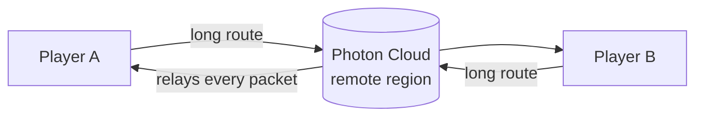
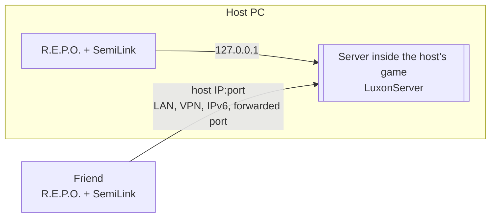
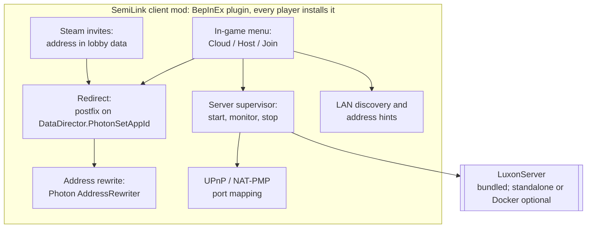
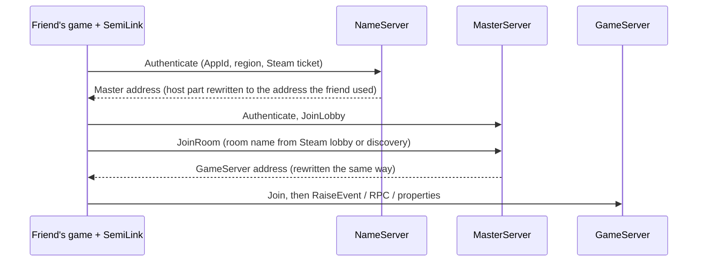

# Architecture

## Today: Photon Cloud

Every packet from A to B goes through Photon's servers. Even for neighbours, latency is the sum of
both legs to the data center. Solo play uses PUN's offline mode, which is why it has no latency.

## With SemiLink: the host's game is the server

Like "Open to LAN" in Minecraft: the host presses **Host**, friends connect to the host's address. The game
believes it is talking to Photon. How the friend reaches the host's address is covered in
[connectivity.md](connectivity.md); the interface is always a plain IP address.

## Components

### Client mod

- **Modes** ([ADR 0003](decisions/0003-in-process-redirect.md)): *Cloud* (inert), *Host*, *Join*.
- **Redirect:** a postfix on `DataDirector.PhotonSetAppId()`, the method the game calls before every
  Photon connect ([open questions](open-questions.md), Q1). In *Host* it sets `AppSettings.Server` to
  `127.0.0.1`; in *Join* to the address the player chose.
- **Address rewrite:** on joining clients, Photon's public `AddressRewriter` replaces the host part of the
  Master and Game server addresses with the address the player used, so any of the host's addresses works.
- **Server supervisor** (*Host*): starts the bundled LuxonServer with a generated config, waits for
  readiness, surfaces errors, stops it on exit.
- **LAN discovery and address hints**, **Steam invites**, **UPnP**: see [connectivity.md](connectivity.md).

### Server

- **LuxonServer**: pinned upstream release, unmodified ([ADR 0001](decisions/0001-use-luxonserver.md)),
  game-version agnostic ([ADR 0007](decisions/0007-listen-server-first.md)).
- Runs inside the host's game session by default. Standalone and Docker packages are optional, for groups
  who want an always-on server ([ADR 0004](decisions/0004-server-distribution.md), [ADR 0007](decisions/0007-listen-server-first.md)).

## Deployment modes

| Mode | Where the server runs | Who it is for | Priority |
|---|---|---|---|
| **Listen server** | Host's game, Host button | Everyone | Primary, MVP |
| **Dedicated server** | Home server or VPS (standalone / Docker) | Groups who want a server up when the host is offline | Optional, later |

Ports (UDP) of LuxonServer: `5058` NameServer, `5055` Master, `5056` Game, plus `27000`–`27002`, which the
game prefers (`AlternativeUdpPorts`).

## Game versions

- Players can only share a room with the same game version: the game uses `<version>.net3` as the Photon
  app version and compares `BuildName` in Steam lobby data. SemiLink keeps this behaviour.
- The server does not depend on the game version; one server can host rooms of different versions.
- SemiLink announces its own protocol version (Steam lobby data, LAN discovery) and shows a clear
  message on mismatch.
- After a game update the mod hook may break; it fails safe to Cloud mode.

## Connection sequence

