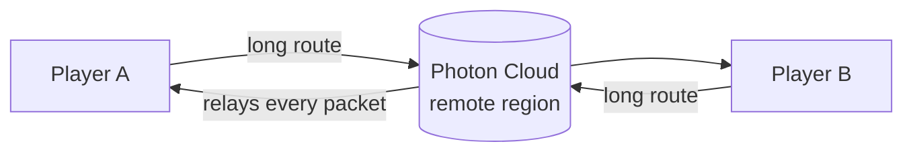
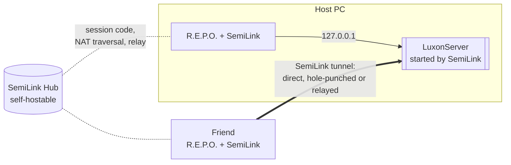
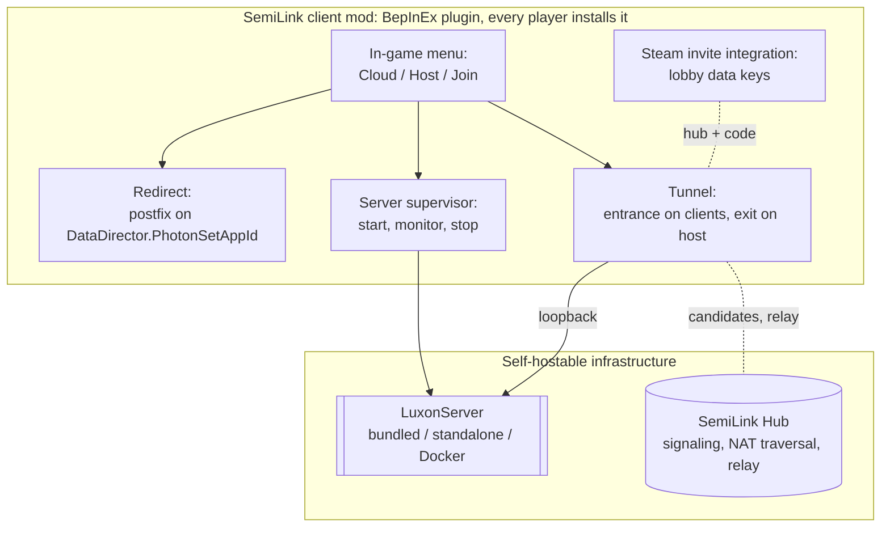
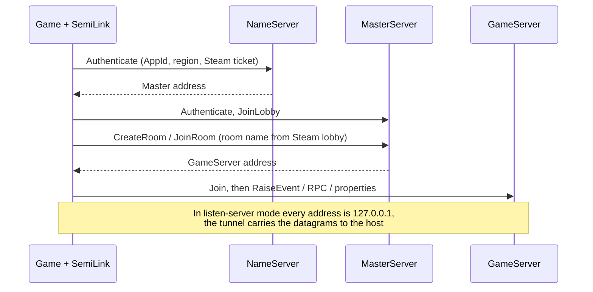

# Architecture

## Today: Photon Cloud

Every packet from A to B goes through Photon's servers. Even for neighbours, latency is the sum of
both legs to the data center. Solo play uses PUN's offline mode, which is why it has no latency.

## With SemiLink

The game believes it is talking to Photon; it is talking to a server on the host's PC (or a dedicated
server). Players need no VPN programs and no admin rights; see [connectivity.md](connectivity.md).

## Components

### Client mod

- **Modes** ([ADR 0003](decisions/0003-in-process-redirect.md)): *Cloud* (inert), *Host*, *Join*.
- **Redirect:** a postfix on `DataDirector.PhotonSetAppId()`, the method the game calls before every
  Photon connect ([open questions](open-questions.md), Q1). In Host and Join modes it sets
  `AppSettings.Server` to the loopback tunnel entrance (or a dedicated server's address) and the ports accordingly.
- **Tunnel** ([ADR 0006](decisions/0006-built-in-connectivity.md)): forwards Photon datagrams between
  players, picking the best path (LAN, IPv6, UPnP, hole punching, manual address, relay).
- **Server supervisor** (Host mode): starts the bundled LuxonServer with a generated config, waits for
  readiness, surfaces errors, stops it on exit.
- **Steam invites:** adds the Hub address and session code to the game's Steam lobby data so invited
  friends join automatically.

### Server side

- **LuxonServer**: pinned upstream release, unmodified ([ADR 0001](decisions/0001-use-luxonserver.md)).
- **SemiLink Hub**: our own small service for session codes, NAT traversal and relay.
- Distribution: bundled in the mod, standalone archive, Docker ([ADR 0004](decisions/0004-server-distribution.md)).

## Deployment modes

| Mode | Where LuxonServer runs | How friends reach it | Hub needed |
|---|---|---|---|
| **Listen server** (default) | Host's PC, started by the Host button | SemiLink tunnel | For hole punching and relay; LAN, IPv6 and UPnP paths work without one |
| **Dedicated server** | VPS or home server with a public IP (Docker / standalone) | Directly by address, no tunnel | Optional, for session codes |
| **Manual / virtual LAN** | Host's PC | Radmin, ZeroTier, Tailscale or a forwarded port, typed address | No |

Ports (UDP) of LuxonServer: `5058` NameServer, `5055` Master, `5056` Game, plus `27000`–`27002`, which the
game prefers (`AlternativeUdpPorts`). In the listen-server mode they stay on loopback.

## Connection sequence (inside the tunnel)

