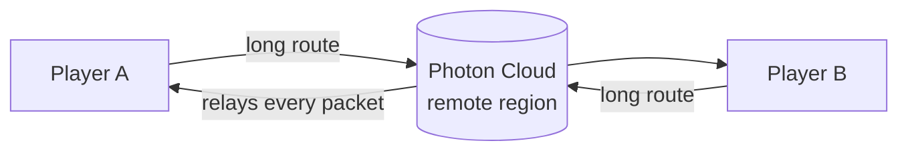
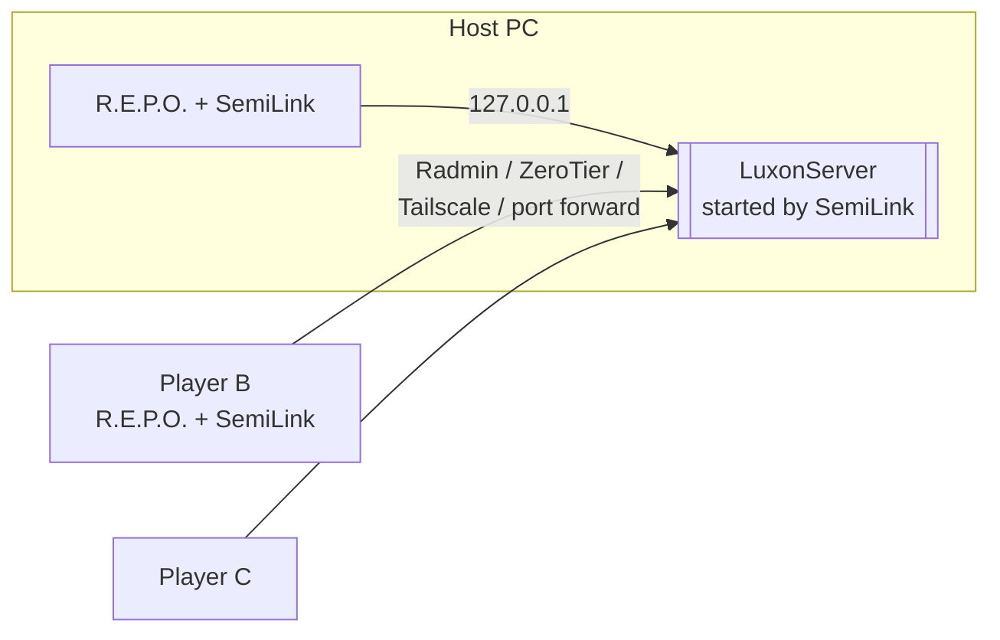
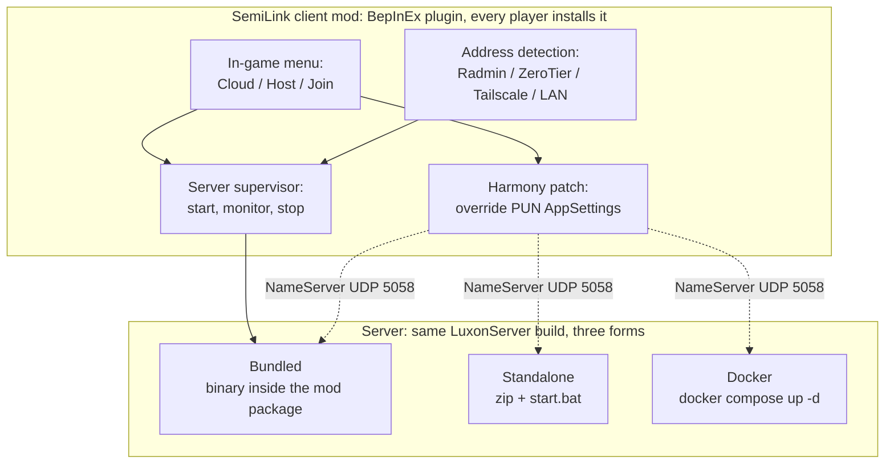
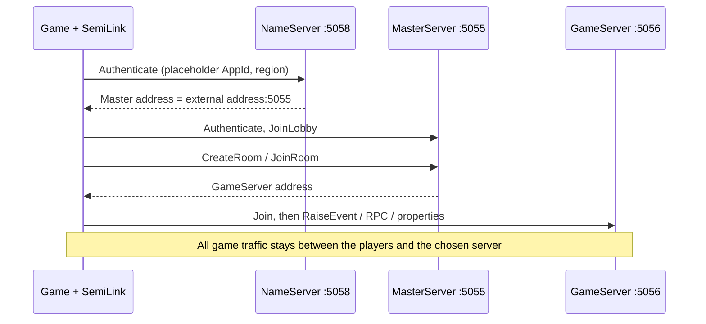
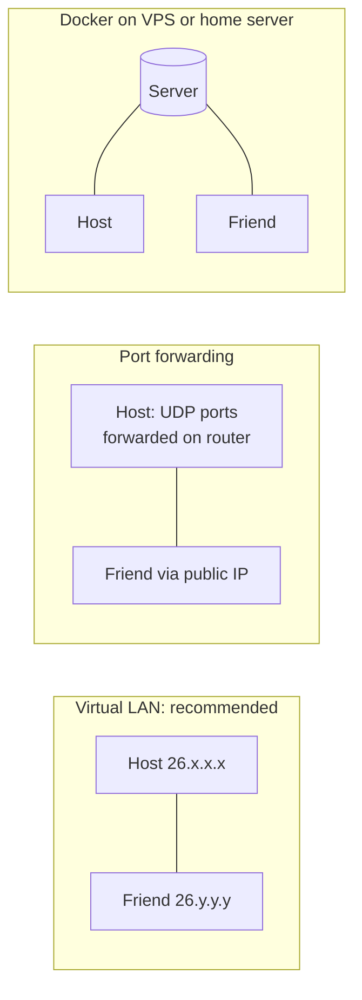

# Architecture

## Today: Photon Cloud

Every packet from A to B goes through Photon's servers. Even for neighbours, latency is the sum of
both legs to the data center. Solo play uses PUN's offline mode, which is why it has no latency.

## With SemiLink

The game believes it is talking to Photon; it is talking to a server on the host's PC, a home server or a VPS.

## Components

### Client mod

- **Modes** ([ADR 0003](decisions/0003-in-process-redirect.md)): *Cloud* (inert), *Host*, *Join*.
- **Redirect:** before PUN connects, override realtime and voice `AppSettings`: server address,
  NameServer port 5058, UDP protocol, placeholder AppIds and region. LuxonServer does not validate them.
- **Server supervisor** (Host mode): start the bundled binary with a generated config, wait for the
  ports to open, show errors in game, stop the server when the game exits or the mode changes.
- **Address detection:** list network interfaces, recognise virtual-LAN adapters by name and address
  range, and offer the address to share, with "Copy" and a manual override.

### Server

Pinned LuxonServer release, unmodified ([ADR 0001](decisions/0001-use-luxonserver.md)), shipped as
bundled, standalone and Docker ([ADR 0004](decisions/0004-server-distribution.md)).

The critical setting is the **external address**: the NameServer tells clients where the
Master and Game servers are, so it must be an address *other players* can reach (virtual-LAN IP, LAN
IP or public IP), never `127.0.0.1`.

Ports (UDP): `5058` NameServer, `5055` Master, `5056` Game, plus fallbacks `27000`–`27002`.

## Connection sequence

## Network scenarios

- **Virtual LAN** needs no router configuration and works behind CGNAT; everyone installs the same
  tool. Tailscale and ZeroTier usually build direct peer-to-peer tunnels; Radmin VPN may fall back to its
  own relays.
- **Port forwarding** gives the lowest latency but needs a public IP and router access.
- **VPS** keeps the server always on; latency depends on where the VPS is.
