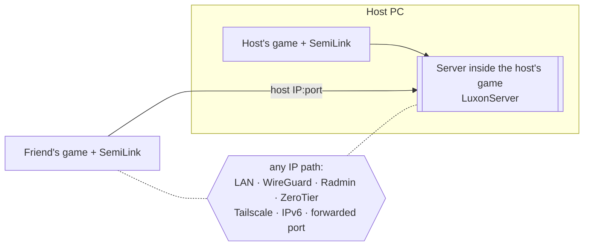
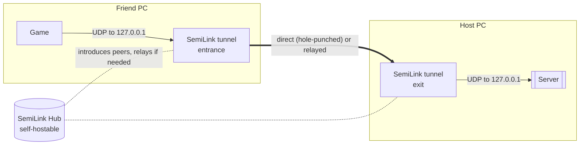

# Connectivity

Status: **design, proposed** ([ADR 0006](decisions/0006-layered-connectivity.md)).

## The problem we solve

R.E.P.O. has no local mode. Even two players on the same LAN, or on a VPN they already use, go through
Photon Cloud. SemiLink restores the **LAN / point-to-point** experience, like "Open to LAN" in Minecraft:
the host's game *is* the server, and friends connect to the host directly.

Note that R.E.P.O.'s networking (Photon PUN) always needs *a* server process: one player cannot connect
straight into another player's game without it. SemiLink runs that server **inside the host's game**
(LuxonServer, started by the Host button), so for players it behaves like peer-to-peer: no separate server
to rent, install or maintain.

## One uniform interface: an IP address

Whatever connects the players, the game and the player see the same thing: **the host's address and
port**. This keeps the system simple and standard:

- every existing tool that gives two PCs IP connectivity works out of the box;
- SemiLink never has to know which tool the players use;
- an optional built-in helper (layer 2) can be added later without changing anything else.

## Layer 1: plain IP (MVP)

| Feature | What it does |
|---|---|
| **Host** | Starts the server inside the host's game and shows the addresses friends can use |
| **Join by address** | Friend types `IP` or `IP:port` |
| **LAN discovery** | Host announces the session on the local network (UDP broadcast/multicast); friends see it in a list and click it. Works on a LAN and on VPNs that pass broadcast |
| **Address hints** | Host screen lists its addresses with labels: *LAN*, *VPN adapter* (WireGuard, Radmin, ZeroTier, Tailscale, recognised by adapter name), *IPv6*, *Public (needs forwarded port)*, each with a Copy button |
| **Steam invites** | Host writes its preferred address into the game's Steam lobby data; an invited friend's mod reads it and joins automatically |

### Any of the host's addresses works

A Photon server tells clients where to go next: the NameServer returns the Master server address and the
Master returns the Game server address. With a single configured "external address", a friend who
reached the host through a *different* address (LAN vs WireGuard vs IPv6) would be sent to an
address they cannot reach.

The joining client avoids this with Photon's **public** `LoadBalancingClient.AddressRewriter` hook: since
all three servers run on the host, the mod replaces the host part of every address the server returns with
the address the player actually used, keeping the port. The host therefore never has to pick "the right"
external address, and every friend can use whichever path works for them.

### Layer 1c: automatic port forwarding

If players have no shared network or VPN, the host's router must accept incoming connections. Many home
routers allow a program to request this automatically (UPnP IGD / NAT-PMP / PCP). SemiLink asks for the
server's UDP ports when hosting and removes the mapping when the session ends. No admin rights on the PC
are needed; it works only if the router allows it and the host has a public IPv4 address (not CGNAT).

## What players do in each situation

| Situation | What works | Extra software |
|---|---|---|
| Same room or same home network | LAN discovery | None |
| Already share a VPN (WireGuard, Radmin, ZeroTier, Tailscale, Hamachi) | LAN discovery or the VPN address from the hints | None from us |
| Both have IPv6 | IPv6 address from the hints | None |
| Host has a public IPv4 and the router supports UPnP | Automatic port forwarding, public address from the hints | None |
| Host has a public IPv4, no UPnP | Manual port forwarding in the router; we document it | None |
| None of the above (for example, CGNAT on both sides) | A VPN of their choice, a dedicated server, or **layer 2** if we build it | VPN, or nothing with layer 2 |

The last row is the only case layer 1 does not cover on its own. Test reports record which row each
session fell into, so we know whether layer 2 is worth building.

## Layer 2: built-in connection helper (future, only if needed)

For players with no path at all, SemiLink can connect them itself, the way commercial games do (Steam
Networking, Epic Online Services, WebRTC): a small coordination server introduces the players, they
**punch holes** through their NATs and talk directly, and if that fails the traffic goes through a
**relay**.

Design notes, kept for when the decision is taken:

- **Same interface:** the game connects to `127.0.0.1`, the local tunnel entrance. Layer 1 stays unchanged.
- **Datagram forwarding only:** Photon already has reliable UDP; the tunnel adds no reliability layer
  and only a few bytes of header.
- **SemiLink Hub:** self-hostable single binary / Docker image (C#, .NET 8). Session codes, address
  reflection (STUN-like), hole-punch coordination, relay restricted to session members with bandwidth caps.
- **Security:** the tunnel exit forwards only to the server's loopback ports; per-session tokens;
  payload encryption so a relay cannot read or alter traffic.
- **Alternatives to building it ourselves:** Steam Networking Sockets (already shipped with the game via
  Facepunch.Steamworks; NAT traversal and Valve relays, no own infrastructure, but depends on Valve and its
  relay locations); LiteNetLib NAT-punch helpers. Evaluate them before writing our own protocol.
- **Wire protocol** documented in `docs/protocol.md` and versioned before implementation.

## Risks

| Risk | Mitigation |
|---|---|
| LAN discovery does not pass through some VPNs | Address hints and manual join always work |
| Wrong address chosen by the player | Labelled hints, Steam invites carry the address automatically |
| UPnP disabled or CGNAT | Clear message explaining the options in the table above |
| Windows Firewall prompt on first Host | Expected for an incoming server; explain it on the Host screen |
