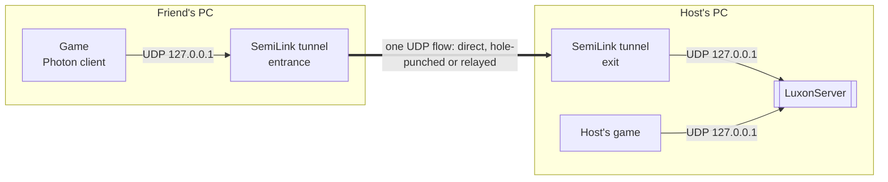
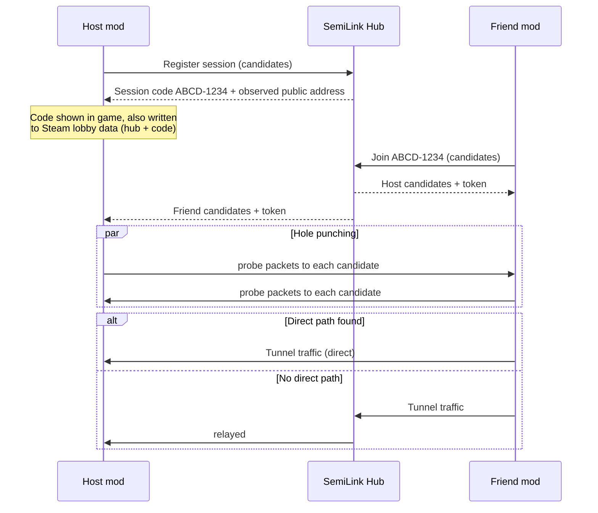

# Connectivity: built-in tunnel and SemiLink Hub

Status: **design, proposed** ([ADR 0006](decisions/0006-built-in-connectivity.md)).

## Goal

Players connect to each other **without third-party tools** (Radmin VPN, ZeroTier, Tailscale, Hamachi),
**without administrator rights**, and without router configuration in the common case. All
infrastructure involved can be self-hosted by anyone, as a single binary or a Docker container.

Third-party virtual LANs and plain IP addresses keep working as a fallback ("Direct" path), but are not
required.

## How online games solve this

| Model | Examples | How it works |
|---|---|---|
| Dedicated server | Photon Cloud, CS2 servers | Everyone connects to a server with a public IP. Simple, but someone pays for and hosts it, and latency depends on its location |
| Listen server + NAT traversal + relay | Steam Networking (SDR), Epic Online Services P2P, Unity Relay, WebRTC (ICE/STUN/TURN) | One player hosts. A **rendezvous** server introduces peers and tells each its public address; peers **punch holes** through their NATs and talk directly; if that fails, traffic goes through a **relay** |

SemiLink supports both:

- **Listen server** (default): the host's game runs the server; friends reach it through the SemiLink
  tunnel, which uses NAT traversal with a relay fallback, coordinated by a **SemiLink Hub**.
- **Dedicated server**: LuxonServer, and optionally a Hub, on a VPS or home server with a public IP;
  clients connect directly.

## Why a tunnel works with the game unchanged

Facts from the game code ([open questions](open-questions.md)):

- `DataDirector.PhotonSetAppId()` is the single place where the game sets `AppSettings.Server`
  and `Port` before every connect. The game itself contains a debug "local server" mode that uses the same fields.
- The game uses Photon's alternative UDP ports (27000–27002) and UDP.

So the client mod can point the game at **`127.0.0.1`**. On a client PC, the mod listens on those
loopback ports and forwards datagrams through the tunnel to the host, where the host mod hands them to
LuxonServer. The game and LuxonServer each believe they talk to a local peer.

Key properties:

- **No extra reliability layer.** Photon already has its own reliable UDP; the tunnel forwards
  datagrams as-is (unreliable, unordered), so it adds no head-of-line blocking and only a few bytes of
  header per packet.
- **LuxonServer's external address is `127.0.0.1`.** Master and Game server addresses it hands out
  resolve to the local tunnel entrance on every client.
- **Multiplexing:** each game-side UDP flow (port × local source port) maps to a stream ID; on the host,
  each remote stream gets its own loopback socket towards LuxonServer, so the server sees independent peers.
- **LuxonServer binds to loopback only** if configurable (to verify), so it is never exposed and
  triggers no firewall prompt. Remote players can reach it only through the tunnel.

## Path selection (ICE-like)

The host and each joining client gather **candidates** and try them in parallel. The first one that
completes a handshake wins; the rest are dropped.

| Priority | Candidate | When it works |
|---|---|---|
| 1 | LAN address | Same local network |
| 2 | IPv6 global address | Both players have IPv6 (no NAT at all) |
| 3 | UPnP / NAT-PMP mapped port on the host's router | Router allows it (many home routers); no PC admin rights needed |
| 4 | Public address observed by the Hub (hole punching) | Most home NATs ("cone" NATs) |
| 5 | Third-party virtual LAN or manual address ("Direct") | User already has Radmin/ZeroTier/… or a forwarded port |
| 6 | **Relay through the Hub** | Always, including symmetric NAT and CGNAT on both sides; latency depends on Hub location |

The mod shows which path is active ("Direct", "Hole-punched", "Relayed via hub.example.org") and its
round-trip time.

## Session flow

### Steam invites

The game links Steam lobbies to Photon rooms through lobby data keys (`RoomName`, `Region`,
`BuildName`, `BuildBranch`, `HasPassword`). The host mod adds its own keys (Hub address and session
code). When a friend accepts a Steam invite, their mod reads them and joins the tunnel **before** the game
connects to Photon. Result: the normal in-game invite flow works with no codes typed.

## SemiLink Hub

A small self-hostable service (single binary, Docker image). Responsibilities:

| Function | Notes |
|---|---|
| Session registry | Short human-friendly codes, expire when the host leaves |
| Signaling | Exchanges candidates and one-time tokens between host and clients |
| Address reflection | Tells each peer its public IP:port as seen from the internet (STUN-like) |
| Relay | Forwards tunnel datagrams when no direct path exists; only between members of one session, with per-session bandwidth caps |
| Health | `/health` and basic metrics for self-hosters |

It never sees game logic, only opaque datagrams and session metadata.

**Who runs a Hub?** Anyone. The mod ships with a configurable list of hubs. Whether the project runs
a public default hub (cost, abuse, jurisdiction) is an open decision; without one, groups use a hub run by
one of their members, or rely on paths 1–5.

A Hub on a VPS can run **next to LuxonServer**: that is the "dedicated server" package
(`docker compose up -d` with both).

## Security

- The tunnel exit forwards only to LuxonServer's loopback ports; it is not a general-purpose VPN.
- Session tokens are issued by the Hub per join; unauthenticated datagrams are dropped.
- Relay only between members of the same session, with rate and bandwidth limits; no open relay.
- Tunnel payload encryption (for example, AEAD with a key from the session handshake) is planned so
  the relay cannot read or alter traffic; Photon traffic itself is not encrypted by default.

## Implementation stack

- **Tunnel**: C# inside the mod (plain `System.Net.Sockets` UDP), protocol code in a shared library.
- **Hub**: C# on .NET 8, same shared protocol library, published as a single-file executable and a Docker image.
- The wire protocol is documented in `docs/protocol.md` before implementation, and versioned.
- Consider [LiteNetLib](https://github.com/RevenantX/LiteNetLib) (MIT) NAT-punch helpers vs our own minimal
  implementation during the spike; do not add its reliability layer on top of Photon's.

## Alternative considered: Steam Networking as transport

The game already ships Facepunch.Steamworks 2.4.1, which exposes Valve's Steam Networking Sockets: P2P
by Steam ID with NAT traversal and fallback through Valve's relay network (SDR), no own infrastructure.

| | Own tunnel + Hub | Steam Networking |
|---|---|---|
| Own infrastructure needed | A Hub only for punching/relay | None |
| Self-hostable, independent of third parties | ✅ | ❌ depends on Valve |
| Relay location | Wherever you put the Hub | Valve's points of presence (may be far) |
| Works only with a Steam account that owns the game | No (our policy still applies) | Yes |
| Effort | Higher | Lower |

It can be added later as an additional path behind the same tunnel interface. See ADR 0006.

## Risks and how we check them

| Risk | Mitigation |
|---|---|
| Symmetric NAT / CGNAT on both sides | Relay fallback; measure how often it happens in test reports |
| Relay latency | Self-hosted Hub close to the group; multiple hubs in the list, pick by RTT |
| LuxonServer cannot bind to loopback or change ports | Ask upstream; otherwise restrict with the tunnel exit and document firewall behaviour |
| Photon timeouts during path switching | Establish the tunnel before the game connects; no path switching mid-session in v1 |
| Two game instances on one PC (testing) | Configurable tunnel ports |
